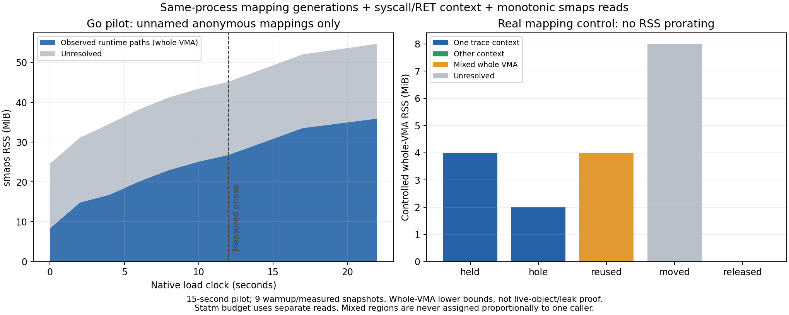

# 映射生命周期与同进程整VMA驻留对齐

接PR27合格的入口/RET/白名单尾出口上下文，在同一逐线程序号流中增加mmap、munmap、mremap、brk的系统调用入口/退出，并记录exec边界。只取唯一目标二进制exec之后的台账；再次exec或缺失配对拒绝，不把启动shell/setpriv/env的旧地址空间转移到目标进程。

CPP mmap包装入口长度和返回值必须与其内嵌真实mmap syscall一一匹配。上下文仍要求PID/UID、完整逐线程序号、时间及RSP嵌套闭合；BPF与Python smaps读取都显式使用CLOCK_MONOTONIC。外部读取同时校验PID启动时间和实际exe inode，保存原始gzip、SHA、完整原point与读取前后时间；原native样本、资源预算和业务检查不改。读取在checkpoint100ms内且耗时不超过100ms，目标point前后必须相同。

每个成功mmap产生独立代次，页长按实际支持的4096页向上取整；部分munmap分裂/删除区间，MAP_FIXED替换产生新代次，地址复用不继承旧标签。mremap新旧区间均不继承已知来源（含DONTUNMAP）；brk变化只撤销潜在旧归属，初始exec/heap等非mmap来源保持未知。失败固定映射或失败删除/重映射也保守撤销潜在影响范围，不凭失败假造成功分配。

并发且范围重叠、无法确定真实生效顺序的变更保留未知。只有整个未命名匿名VMA被完整覆盖，读取前后来源与代次集合相同、且读取期间没有触及范围的在途变更，才将该整VMA的Rss关联至来源路径。多来源混合单列，不按地址长度分摊RSS。Go标注、shadow、metadata和文件等原分类分开保留。驻留关联是映射申请路径证据，不是对象存活、缓存用途、可回收或泄漏证明。

先用真实C控制验证：隔离保护页内4MiB触碰映射→解除中间2MiB→不同上下文MAP_FIXED复用→完整合并VMA混合来源→mremap移到8MiB并触碰→解除。每阶段保存原始marker/monotonic时钟及smaps；新地址和旧地址不跨阶段猜测。所有控制、台账、清理和读取守卫通过后，才运行原H2 mode1的15秒资格窗口（12秒预热、5秒采样、TLS1、pool16:64、2worker10QPS）。这不是180秒或24小时验收。

继续固定BFD-enabled bpftrace0.21.2源码，unsafe关闭；不使用uretprobe或栈展开，不修改生产Go探针/internal/cmd/依赖、GORACE/GODEBUG或内核BPF/ptrace/THP策略。进程组及实际父子身份验证沿用PR27，任何超时/强制清理/缺失证据失败并阻断后续。77项Python通过，真实C控制本地执行成功；实际CI及独立复核如下，原64MiB增长预算、历史失败及24h pending不变。

依据：[bpftrace0.21时钟与tracepoint说明](https://bpftrace.org/docs/0.21)、[Linux mmap/munmap](https://www.man7.org/linux/man-pages/man2/mmap.2.html)、[Linux mremap](https://www.man7.org/linux/man-pages/man2/mremap.2.html)。smaps不是原子全进程快照，不能强制与另一次statm读取精确加总一致；未覆盖或不稳定部分不作正向归属。

## 实测版本及首次审计错误

初版源码`e4634f1bce39a7edc9295e34fe412e480ce447a8`，CI检出`07c04511e1d0d56908cb445948cc811a29667ec3`；树均为`39939b46a1ce5b413ca9a0ad3d0dbaa6ef404132`。修正版源码`e1ca81e368ed32673675c032dc23401c5319cf9d`，CI检出`5ea1d8e34061123067bfc96f18860fd2468012b1`；树均为`961a8573e1ba8851579e01ef25805d08933bfb4f`。四个实际git对象已核对，两个Go构建均干净且指向实际CI检出。

[初版CI40438651313](https://github.com/VortexWang/Tunveo/actions/runs/40438651313)failed保留：生命周期控制通过、Go15秒业务完成，但审计误把native报告发布后晚填的checkpoint_seconds/snapshot_seconds当作资源变化。原Go snapshot实现是在写出报告后才设置这两项耗时；九个采样的资源、计数、采样时间、measure_seconds原文都未变，只有这两个0→最终时长变化。

修订只允许这两个字段从0完成有效计时包络，非0值不得再变；资源/业务/采样时间/测量耗时等核心字段全部冻结，新增原始发布点及核心SHA。最终耗时必须有限、非负且总snapshot耗时覆盖measure+checkpoint。新schema2逐点核验hash；旧schema1仅用于原始证据复读，不补造当时不存在的hash。冻结旧审计器在同一不可变ZIP上仍报native point changed，新审计器严格复算另存，不把旧CI回写绿。另将brk在途/并发可能影响范围保守扩大，避免低地址已知映射被误认稳定。

[修正版CI40439600226](https://github.com/VortexWang/Tunveo/actions/runs/40439600226)成功；共享追踪器的原上下文资格回归40439600166也成功，后者只复核状态，不算本表新增台账窗口。

## 真实生命周期控制

两版均完整采集held/hole/reused/moved/released五阶段，控制与目标/观察者实际进程组都正常结束、身份已验证、无TERM/KILL或超时。所有阶段CLOCK_MONOTONIC读取、PID启动时间/exe inode及原文SHA匹配，耗时/距marker均在原100ms界限内。

| 阶段 | 控制范围内实际整VMA驻留 | 台账与归属检验 |
|---|---:|---|
| held | 4MiB | 初始保护区中心固定映射，完整Trace上下文代次 |
| hole | 2MiB | 中间2MiB真实缺口，原映射拆成两块 |
| reused | 4MiB | 中间由另一上下文复用，内核合并VMA，整块只标混合 |
| moved | 8MiB | 实际mremap移动并触碰，不能把旧代次/来源搬到新址 |
| released | 0MiB | 新址已解除，无旧归属残留 |

普通mremap移动有真实控制；DONTUNMAP、失败固定映射、并发重叠、同类别地址复用和读取期间变更等保守规则另由单测验证，不把单测称为所有内核路径已实测。完整台账支持的是本实验声明的mmap/munmap/mremap/brk与exec边界，不声称通用支持所有地址空间API或完整对象生命周期。

## 两个实际Go窗口

两版各一次15秒原负载，12秒预热、5秒采样、H2 mode1/TLS1、pool16:64、2worker10QPS及单次业务尝试不变；均150业务（114TCP/36UDP）与269含预热事件全部成功、无丢弃/重试且正常回收。两个完整窗口合计300业务/538事件；初版专项仍因上述审计错误failed，后续离线分析不覆盖该状态。

| 版本 | 后半预热RSS峰值→measured峰值增量MiB（预算口径） | measured首末采样RSS差MiB（趋势口径） | 原资源守卫 |
|---|---:|---:|---|
| 初版 | 43.984375 | 43.5078125 | 通过，专项审计仍failed |
| 修正版 | 46.51171875 | 42.3046875 | 通过 |

两种量不能混用。PR27旧文字曾把24.91015625MiB趋势差写成预算增量，本PR从其已发布不可变ZIP复算并更正：后半预热峰值131227648B→measured峰值162365440B，预算增量31137792B（29.6953125MiB）；24.91015625MiB只为measured首末差。原始数据和原通过判定不变，更正证明见pr27-rss-envelope-correction.json。

## 同进程驻留关联结果

修正版190032条有序记录闭合；唯一目标exec之后的内存syscall台账包含mmap467对、munmap30对、brk3对，Go窗口未调用mremap（该路径由前述C控制验证）。CPP包装mmap与真实syscall长度/返回值一一对应。九个warmup/measured点都有原始smaps及相同资源核心，最后一个映射读点为本机load时钟22.008秒；native完整15秒measured业务至约27秒结束，drained/after_stop不作为本次外部映射覆盖。

原预算选点：后半预热RSS峰值在8.003秒，原statm118.0820MiB；measured峰值在22.008秒，164.5938MiB，增量46.5117MiB。下表均使用该同进程峰值对应的邻近原始smaps读取，并非把不同进程地址或历史80MiB数字搬来。

| 细分已观测路径（整VMA） | 峰值未命名匿名RSS MiB |
|---|---:|
| 单一TraceSwitchPartImpl路径 | 0.1328 |
| 单一InternalAlloc路径 | 3.7188 |
| 多条已知路径混合，不分给单一路径 | 11.6172 |
| 细分层级未归属 | 39.2148 |

细分表里一部分未知只是无法细分至单一入口路径。独立审计另问更宽的问题：计划中的三个精确符号全部来自同一Go race运行库，将**实际非空已观测上下文**统一为运行库路径家族，再沿用原始调用、代次、失败撤销、并发/在途变更和整VMA完整覆盖规则重放。空上下文、mremap新址或不完整覆盖仍不能改标已知。

| 运行库路径家族视图（同一批VMA） | 峰值未命名匿名RSS MiB |
|---|---:|
| 完整关联到已观测race运行库路径 | 35.9062 |
| 仍未归属 | 18.7773 |
| 未命名匿名合计 | 54.6836 |

两表是同一批VMA不同粒度视图，不能相加。35.9062MiB是本样本的整VMA驻留关联下界，不是累计虚拟申请，也不是单独TracePart或缓存类型证明；其中混合区间没有按虚拟长度分摊。该家族视图为独立审计从原始已验证上下文重算的补充，不修改CI原细分类结果。

同样选点，运行库家族关联量从22.9648→35.9062MiB，未归属从18.2695→18.7773MiB。其他Go命名、shadow、metadata、文件等仍独立列出，没有将整个进程RSS都算入该家族。smaps和statm为相邻非原子读取，不能强制差值精确相加。这也不追溯说明历史180秒约80MiB匿名驻留全部同源，不证明泄漏或长期有界。

## 独立复核与剩余范围

两份原始CI ZIP发布digest/CRC、实际Git树、BFD安全构建来源/cache、包装函数/内核syscall配对、全部逐线程台账、exec隔离、实际进程关系及清理、五阶段控制、九个读点的原始smaps/SHA/时间/资源核心/计时晚填规则均已复核；原smaps_rollup字段亦重解析。细分与家族视图逐点RSS总量守恒，均不比例分摊。初版旧错误在冻结原审计器中重现，所有原文和状态保留。

77项Python通过；共享追踪器回归专项成功，当前常规CI40439600256的19/19成功；TLS验收40439600264失败，本轮只复核该另轮状态，不作新的完整兼容覆盖声明。状态快照另存，不宣称全部回归已绿。科学图及审计脚本、原始ZIP、当地C控制执行记录、口径更正、独立结果和逐文件SHA清单见docs/evidence/soak-mapping-ledger。

生产Go探针/internal/cmd/依赖未改，64MiB预算和全部历史失败保留，正式24h仍pending、未启动；保持草稿，未合并/打标签/发布。下一步在相同观测和预算下扩展至180秒，复现超限并观察这些路径的驻留与解除/复用，而不是从短窗口直接推断24小时结论。
