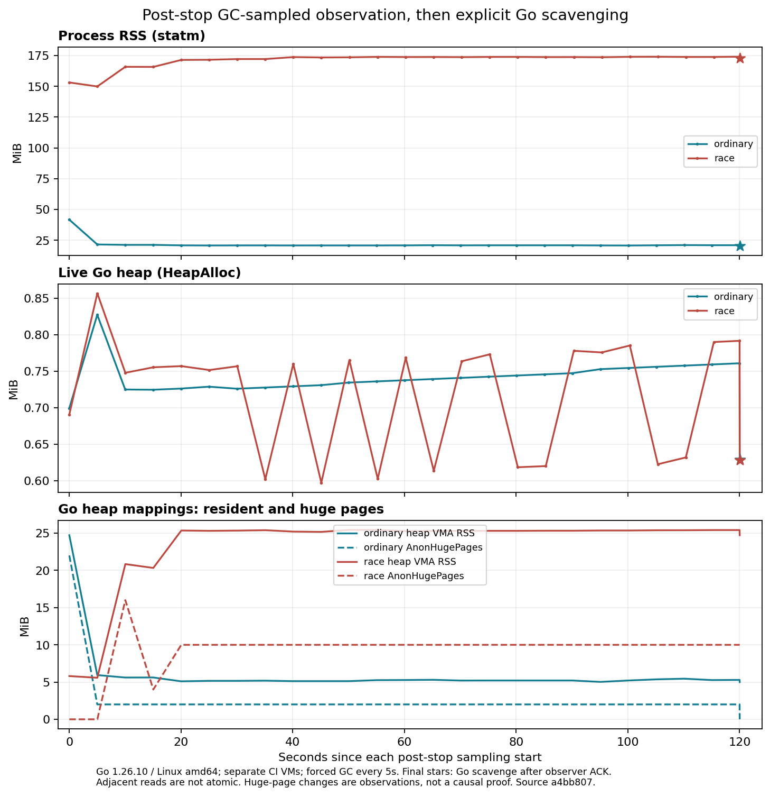

# 停载保留内存与Go堆回收对照（2026-10-27）

接PR23。前轮无strace180秒race RSS+80.0625MiB超过64MiB预算；带跟踪窗口有20.3828MiB匿名增长关联到sanitizer mmap路径，但调用栈止于internal_mmap，尚不能细分内部用途。本轮优先区分停载后保留与Go堆可回收的内存，不修改生产引擎或依赖，不打开TSan flush_memory、不降低history，不增加64MiB预算。

## 追加诊断阶段

保留原H2 mode1/TLS1、pool16:64、2worker10QPS、12秒预热+180秒测量、5秒采样、单次业务尝试。原Stop、after_stop回落判定、业务日志/事件关闭与夹具清理完成后，追加独立120秒观察。沿用measure()的runtime.GC采样，每5秒记录，**不是不受干预的自然空闲观察**。随后可选一次debug.FreeOSMemory，单独标poststop_go_scavenge并记录耗时；最后留5秒让外部读取器完成。

[Go1.26.10源码](https://github.com/golang/go/blob/go1.26.10/src/runtime/debug/garbage.go)说明FreeOSMemory先GC，再尝试向OS返还内存。它不是保证清空所有RSS的接口；未修改全局GC比例、内存上限或race策略。显式Go回收发生于停载观察之后，不能解释为生产引擎修复或正式验收的一部分。

新post_stop_observation数组使用“清理完成后首个采样开始”的独立时钟。原Points、Counts、Measured、Idle、after_stop及调度计时不改；外部采集每个停载快照时冻结这些原字段的哈希，独立审计要求最终相同，防止回收阶段重写原负载失败。原RSS验证仍只用原预热/测量窗口，原after_stop仍来自原回落逻辑，不用后面的更低值替换。

正式模式的命令和原始报告验证均拒绝停载实验；native探针也拒绝24小时及更长负载携带此诊断。所有结果pilot/qualifies_24h=false。执行超时只按明确追加的观察时长延长，业务/资源预算不变。一次资源失败仍使CI失败，即使后面的RSS下降也不改绿。

## 控制与复核

新增真实32MiB Go分配、逐页触碰并持有，记录held、释放后的GC、显式Go回收后三个样本；已知对象不再存活后HeapAlloc应下降至少24MiB，最终HeapReleased应比持有时增加至少16MiB。记录每阶段原文，不预设GC后与显式回收之间一定释放多少RSS，也不假设race shadow按同样幅度释放。

Go协议测试核对追加记录不改原Points/after_stop/计数，并验证checkpoint失败时不会继续进入显式回收。最初1ms单位测试误要求至少3个点，而一次测量即可耗尽1ms；已修正为检查实际两阶段，初版测试日志保留，未改观察窗口或资源控制阈值。普通控制与race完整包测试通过，Python43项通过，包括拒绝正式验收携带诊断以及阶段顺序/完整性。

外部smaps仍有观察者开销与异步误差。独立审计重读原始映射、rollup、文件清单、事件和日志；单独比较停载初始、120秒末、显式Go回收后的命名Go堆、shadow、metadata和未命名匿名驻留。后者不因所在进程是race就直接标为某种trace缓冲。各读取不可精确加总到另一时刻的statm。

前轮规范源码73e8a40常规CI最终19/19成功，独立映射回归成功；TLS最终8/11分片成功，3个失败均为旧服务端配对（TLS0/1/2），未在此重做整矩阵失败格数或兼容性覆盖声明。PR23的RSS资源失败、初版解析失败及历史失败均保留。

规范源码、实际曲线及原始证据如下。正式24小时未启动，未合并、未发布。

首轮0d2b8eb诊断中，ordinary负载通过，但最后GC checkpoint后立即显式回收，10ms外部轮询漏掉了回收前最后快照，严格审计拒绝；race原文完整、因active RSS仍失败。初始两任务保持failed。修正协议为：采样器完成最后GC快照、哈希和时限验证后，发布带phase/时间/映射SHA/原负载SHA的回执，native收到匹配回执才进入显式Go回收；过期、缺失或不及时均失败并不执行回收。没有补拍历史快照或放宽100ms界限。原生直接执行不启用该外部握手，本地自采样结果另列，不能当作完整外部映射覆盖。

## 规范源码和独立审计

握手修正源码`a4bb807e47376bb67368c279f96350543f237735`，CI检出`4eca0f8baeddbfa3aa26253053072eb1007fcfeb`，完整git树均为`b2f54586bf0a2e99d693dd9dca230fdf2485f973`。初版0d2b8eb与CI检出0c1f0db0的树均为f3ff7bb5dd7108c277c57ac01944d7fa9d3052de，经实际对象核对。生产internal/cmd与依赖未改；测试探针的诊断默认关闭，验收预算不变。

[握手版专项CI40404147487](https://github.com/VortexWang/Tunveo/actions/runs/40404147487)2/2成功，完整外部映射和匹配回执均通过独立复读。初版CI40401771313仍2/2 failed：ordinary原负载通过但缺回收前最后映射，不能补拍或当外部诊断通过；race原负载RSS增量75.55859375MiB超限，完整诊断仍保留。

本地原生两个初版干净构建来自同源码、vcs.modified=false，8CPU配额/8GiB，同机并行总20QPS；只使用探针自采样和JSON文件监视，没有重新尝试跨进程proc读取。期间进行轻量元数据/文件复核，不是空闲专用性能机。JSON监视在停载阶段中途开始，只封存各15个后段checkpoint，未宣称完整外部映射覆盖。本地ordinary通过，race原RSS增长74.796875MiB失败。

| 位置/源码 | 构建 | 原负载statm RSS增量MiB | 原负载结果 | 外部停载映射 |
| --- | --- | --- | --- | --- |
| 初版CI 0d2b8eb | ordinary | 8.5664 | passed | 缺最后回收前帧，failed |
| 初版CI 0d2b8eb | race | 75.5586 | failed | 完整 |
| 本地 0d2b8eb | ordinary | 17.4414 | passed | 无，自采样 |
| 本地 0d2b8eb | race | 74.7969 | failed | 无，自采样 |
| 握手CI a4bb807 | ordinary | 8.5859 | passed | 完整、回执匹配 |
| 握手CI a4bb807 | race | 63.9180 | passed | 完整、回执匹配 |

六个实际180秒窗口共10800业务交换/11514含预热事件；每轮1800交换（1350TCP/450UDP），无失败/丢弃/重试，正常回收。四轮原预算通过、两轮资源失败，初版ordinary另有诊断覆盖失败。修订只解决停载快照交接，没有修复负载期RSS；本轮race通过不覆盖本地、初版CI或历史超限。

## 停载与显式Go回收结果

下表为握手版CI各进程的statm绝对RSS；普通/race分别在独立VM，不是严格同机差分。

| 构建 | 停载首GC样本RSS MiB | 120秒末RSS MiB | 显式Go回收后RSS MiB | 最后HeapAlloc MiB |
| --- | --- | --- | --- | --- |
| ordinary | 41.7148 | 20.9688 | 20.2305 | 0.6289 |
| race | 153.1328 | 174.0508 | 172.8555 | 0.6284 |

race显式Go回收后，外部映射仍有约48.9531MiB shadow、2.8789MiB race metadata、79.9531MiB未命名匿名页，以及24.7148MiB Go标注堆驻留；HeapAlloc不足1MiB不表示整个进程只应占1MiB，静态区、闲置/碎片化堆、映射及运行库等均不等于活对象。未命名页也不自动等同某种race trace缓存。后续显式回收只使本次statm约下降1.1953MiB，不能把保留RSS判为已解决，更不能据此单独确认泄漏。

本地自采样也有类似差异：ordinary的停载首/末/回收后RSS约21.223/18.824/18.371MiB；race约149.250/148.211/147.098MiB，最后活堆约0.8MiB。初版CI race回收后RSS约159.004MiB、HeapAlloc约0.620MiB。所有值按来源分别保存，未跨进程搬移分配地址或合并为一个精确内存账本。

图中始终采用原GC采样，最右星标为回执后显式Go回收，三条时间轴只代表各自进程的停载相对时钟。观察期日志/事件已在原清理点关闭，此阶段只采资源，不能据此证明没有任何晚到后台事件。

## 新线索及边界

原始VMA显示，握手版race的Go堆AnonHugePages从0变为10MiB，同一Go堆映射RSS约5.805→25.410MiB，显式回收后仍约24.715MiB且大页仍10MiB；活堆保持不足1MiB。ordinary的Go堆大页则从22MiB降至2MiB、显式回收后0。完整每点原文与逐VMA序列见hugepage-observations.json，没有补出初版ordinary缺失帧。

这只是透明大页相关线索，不是因果证明。依据[Go GC guide](https://go.dev/doc/gc-guide#Linux_transparent_huge_pages)与[Linux THP文档](https://docs.kernel.org/admin-guide/mm/transhuge.html)，页策略可能影响Linux驻留占用；本次没有修改任何THP sysfs或GODEBUG策略，也没有采集CI宿主的完整THP配置，所以不能断言它解释全部增长。HeapReleased也不是物理驻留计数，不能直接从RSS或HeapSys相减推出精确剩余泄漏。下一步应独立比较相同工作负载下的大页策略并记录环境，保留原默认组与原预算。

当前常规CI40404147412的19/19、Soak smoke40404147279的9/9、停载专项2/2，以及映射/时序/WS专项任务状态成功；另分配来源回归任务1/2，race在负载步骤失败，未将该另轮原文算作本次已复核窗口。TLS仍运行中，前轮旧服务端三个分片失败继续开放。没有重新下载普通回归的全部矩阵原文作新的覆盖声明。

全部四份原始CI ZIP发布digest/CRC、文件哈希、事件/引擎日志、校准样本、各停载rollup、每份可用smaps、原验收冻结哈希、回执及计时均独立复核。首轮漏采和单位测试基数错误的日志也保留。见 [evidence/soak-post-stop-retention](evidence/soak-post-stop-retention) 中的原文、重放脚本、来源指纹与SHA256清单。预算不改，正式24小时仍pending，未启动、未合并、未发布。
