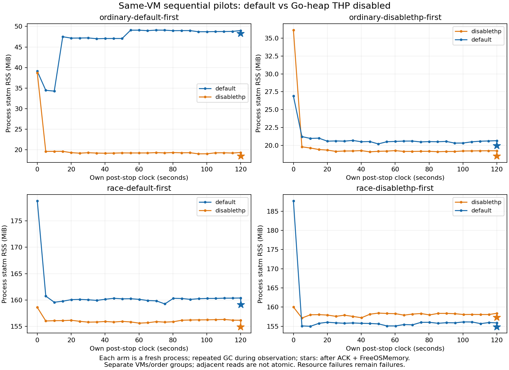

# Go堆透明大页顺序对照

PR24发现race停载观察中Go堆AnonHugePages增加，但没有宿主策略快照，不能认定因果。本实验只改变新建试跑进程的`GODEBUG`：默认组移除该变量，对照组精确设置`disablethp=1`。其他继承的GOGC/GOMEMLIMIT/GOMAXPROCS保留并记录。生产代码和宿主sysfs不改。

每台CI VM同一干净二进制依次运行两组，各180秒H2 mode1/TLS1原负载、12秒预热、120秒停载重复GC观察和一次握手后的FreeOSMemory。ordinary/race各有默认优先、禁用优先两台独立VM，共8个窗口；每组只跑一次，失败不重试，先前失败不覆盖。反向顺序帮助检查顺序影响，不能消除独立VM宿主差异。

采集每组前后完整可读THP sysfs、内核和cgroup限制，读取失败原样记录；跨进程读取实际GODEBUG/GOGC/GOMEMLIMIT/GOMAXPROCS并与声明逐项比较，不存储其他环境变量。保留每个原始smaps及哈希，Go堆整VMA的Rss、AnonHugePages、THPeligible、VmFlags逐点解析；缺字段不补零。禁用组必须每个Go堆映射都有`nh`且AnonHugePages为0，否则诊断失败，不能把未生效处理当对照。所有THP映射读取须在原100ms质量界限内。

现有验收器独立复核180秒负载资源预算、事件和引擎日志、停载冻结哈希、回收前握手。64MiB RSS增长预算不变；停载或禁用组低值不覆盖默认组或历史失败。数据只支持Go堆干预的试验范围，不是race/sanitizer所有映射的大页干预，也不是泄漏定论、生产配置建议或24小时验收。

依据：[Go runtime环境说明](https://pkg.go.dev/runtime#hdr-Environment_Variables)、[Go GC guide](https://go.dev/doc/gc-guide#Linux_transparent_huge_pages)。固定工具链Go1.26.10的runtime源码原文及SHA随CI存档，以确认该版本设置语义。实际结果和来源核验如下。

## 实测与独立复核

规范源码`f988a599714e2acfbc8c904bc9b35a03ece2fd0c`，CI检出`c2381785769c02f5a786f51cfdcc65903c5ba9a3`；两者完整Git树均为`553c88b50cc4227ccd7705b13ef1bb45abf2c108`，已通过实际git对象核对。每对映射报告的二进制SHA相同，Go构建信息干净且指向CI检出。CI归档的mem_linux.go/extern.go与Go1.26.10官方固定标签逐字节SHA相同（08cc392d…/1afbe8b4…）；mem_linux.go的sysMapOS按disablethp调用MADV_NOHUGEPAGE，源码注释限定其他覆盖调用用于GC metadata，因此本实验不称所有runtime/sanitizer映射均受控。

[专项CI40419932078](https://github.com/VortexWang/Tunveo/actions/runs/40419932078)普通两任务成功、race两任务failed，失败正确传播原RSS验收。八个窗口共14400次业务交换（10800TCP/3600UDP）及15352条审计事件，全部业务成功，无丢弃、重试、强杀或未回收子进程；4轮active pass、4轮RSS failed。两轮禁用race也失败，不能把该开关当资源问题修复。

以下MiB统一除以1048576；“最终”均为停载120秒GC观察、外部完成握手、一次Go显式回收后的单独诊断点。增长来自原负载baseline/peak，最终低值不覆盖该结果。各表行是不同进程，不做精确反事实相减。

| 同VM配对/顺序 | 进程策略 | 原负载RSS增长MiB | 原验收 | 最终进程RSS MiB | 最终Go堆VMA RSS MiB | 最终Go堆大页MiB |
|---|---|---:|---|---:|---:|---:|
| ordinary-default-first | default | 8.5664 | pilot_passed | 48.2969 | 33.0781 | 12 |
| ordinary-default-first | disablethp | 17.0977 | pilot_passed | 18.4805 | 3.3047 | 0 |
| race-default-first | default | 72.5625 | failed | 159.1328 | 7.5078 | 2 |
| race-default-first | disablethp | 79.0312 | failed | 154.9297 | 3.1328 | 0 |
| ordinary-disablethp-first | disablethp | 15.4219 | pilot_passed | 18.4922 | 3.2891 | 0 |
| ordinary-disablethp-first | default | 8.6562 | pilot_passed | 19.9570 | 4.6133 | 0 |
| race-disablethp-first | disablethp | 83.5586 | failed | 157.3203 | 4.4062 | 0 |
| race-disablethp-first | default | 71.3086 | failed | 154.8516 | 5.8125 | 0 |

所有禁用组每个已采集Go堆VMA均有nh标志，AnonHugePages全程为0；四个默认组曾观测到Go堆大页，整个采样序列最高分别40/44/36/50MiB（表格最终点可能已降至0）。这确认干预及默认组大页现象，但不能把两个异时进程的全部RSS差归因于单项开关。

普通默认优先VM停载末Go堆驻留33.3359MiB，显式回收后33.0781MiB、大页12MiB；同VM禁用组最终堆驻留3.3047MiB、大页0。另一普通VM默认组最终只4.6133MiB、大页0，体现默认大页/驻留波动，不能声称固定节省量。

race禁用组最终进程RSS仍154.9297/157.3203MiB，HeapAlloc约0.6286/0.6253MiB；整VMA归组中，shadow约52.6211/52.8594MiB、race metadata约2.9922/3.4258MiB、未命名匿名约79.8984/80.3008MiB。未命名匿名页在本轮没有调用栈，不直接称为trace缓存或全部sanitizer所有；statm与外部smaps为相邻读取，不精确强加总。本轮仅说明Go堆大页不是这两轮race超限的必要条件，不能追溯认定每个历史失败同因，也不证明残留全是泄漏。

所有VM每组前后所选THP策略读取一致：enabled=`[always] madvise never`、defrag=`always defer defer+madvise [madvise] never`、max_ptes_none=`511`；完整可读sysfs、读取错误、内核和cgroup原文保留。不把所选策略一致扩展成宿主所有状态静止；同VM序列仍存在页分配与时间波动，反转顺序也不能消除全部混杂。

独立审计先核对四份原始发布ZIP的digest及CRC，再从原始报告/事件/日志/smaps重跑原资源验收、停载冻结SHA和ACK时限、全部THP字段与100ms读取界限，并与CI计算结果逐项相等；没有按结果选择重跑。46项Python测试通过。常规CI40419931973最终19/19通过，映射专项成功；同期既有停载/分配来源race任务failed（仅复核状态，不算本表已审计窗口），TLS仍运行，不宣称全部CI成功。

证据在`docs/evidence/soak-thp-control`：四份原始ZIP逐份保留、发布元数据、原始字段重算结果、官方工具链源码/指纹、绘图/审计脚本与逐文件SHA清单。预算、历史失败、正式24小时pending和草稿状态不变；未合并、打标签或发布。下一步优先收窄未命名匿名页的分配/保留来源，继续保持原预算，不把THP开关写入生产默认值。
